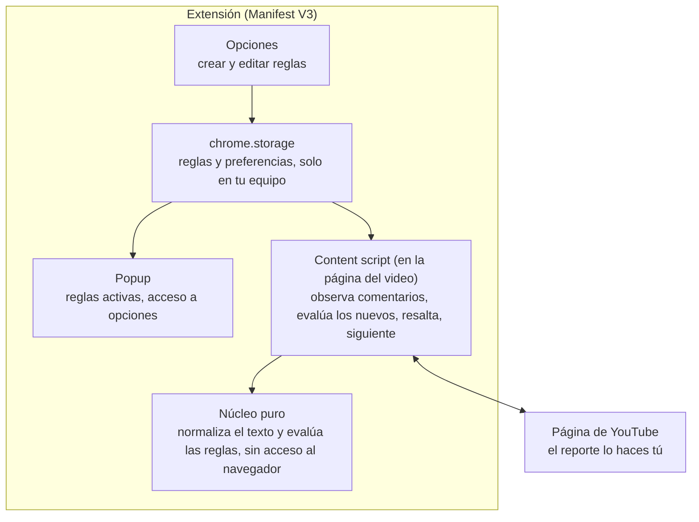

# Extensión anti-spam para comentarios de YouTube — Arquitectura y plan

Última actualización: 10 nov 2026 · Autor: Habib Jassir

## Resumen

Una extensión para Chrome y Brave, sin IA, para quien mira videos: mientras se cargan los
comentarios los evalúa con tus reglas y resalta los sospechosos, sin que tengas que pulsar
nada. El reporte lo haces tú con el menú de YouTube; la extensión no reporta ni hace clics
por ti.

### Decisiones confirmadas

| Tema | Decisión | Fecha |
| --- | --- | --- |
| Usuario | Solo el espectador. Se eliminó el modo dueño del canal. | 10 nov 2026 |
| Disparador | Escaneo automático conforme se cargan los comentarios | 10 nov 2026 |
| Permisos | Content script declarado en `youtube.com` (ADR-002, opción A) | 10 nov 2026 |
| Detección | Tres detectores deterministas, sin IA y sin puntaje | 10 nov 2026 |
| Longitud | Límite de palabras por regla; una regla que coincide basta para marcar | 10 nov 2026 |
| Idioma de la interfaz | Español e inglés | 10 nov 2026 |
| Superficies | Videos normales y Shorts. El chat en vivo queda para después. | 10 nov 2026 |
| Stack | WXT, TypeScript y React | 10 nov 2026 |
| Repositorio | Público. Los casos de prueba usan seudónimos. | 10 nov 2026 |
| Autoría en Git | Commits, pull requests y merges solo con la identidad de Git del autor | 10 nov 2026 |
| Distribución | Uso personal, carga manual | 9 nov 2026 |

Al quitar el modo dueño desaparecieron la API de YouTube, el inicio de sesión con Google,
la cuota diaria, la cola de acciones y el service worker. ADR-001 (credenciales del modo
dueño) quedó retirado.

### Alcance

| Nivel | Incluye |
| --- | --- |
| MVP | Motor de reglas, página de opciones, escaneo automático, resaltado con motivo, contador, ir al siguiente sospechoso, Shorts, interfaz en dos idiomas |
| Post-MVP | Importar y exportar reglas, detección de texto duplicado, atajo de teclado |
| Opcional | Chat en vivo, publicación en Chrome Web Store |

## Restricciones que definen el diseño

Un espectador no tiene forma oficial de reportar por programa, así que la extensión detecta
y señala, y la persona reporta.

| Hecho | Consecuencia para el diseño |
| --- | --- |
| `comments.markAsSpam` está obsoleto y ya no funciona ([historial de la API](https://developers.google.com/youtube/v3/revision_history)) | No existe reporte de spam por API para ningún usuario. |
| Los términos de YouTube prohíben el acceso por medios automatizados sin permiso ([cláusula](https://conductatlas.com/platform/youtube-ads/youtube-terms-of-service/provision/CA-P-022046/prohibition-on-automated-access-without-permission/)) | No se simulan clics en el menú de reporte. Hacerlo arriesga la cuenta del usuario. |
| YouTube carga los comentarios por partes, al bajar en la página, y las respuestas quedan plegadas | La extensión solo ve lo que ya está cargado. Evalúa lo nuevo conforme aparece. |
| La estructura de la página de YouTube cambia sin aviso | Los selectores viven en un solo archivo. Si no se encuentra ningún comentario, la extensión lo dice en vez de mostrar "0 sospechosos". |

Las dos últimas filas se confirmaron el 10 nov 2026 al leer videos reales (ver "Hallazgos").

## Arquitectura

La extensión tiene cinco piezas y ninguna sale del navegador: no hay servidor, ni cuenta,
ni llamadas a YouTube. Un núcleo puro decide y una capa delgada lee y pinta la página.

| Componente | Responsabilidad |
| --- | --- |
| Núcleo puro | Normalizar texto y ejecutar los detectores. No importa `chrome.*` ni toca la página. Se prueba sin navegador. |
| Lector de página | Parte del content script. Convierte los comentarios visibles en datos simples: texto, autor, si es respuesta y elemento. Todos los selectores viven aquí. |
| Resaltador | Parte del content script. Marca cada comentario sospechoso con el motivo y permite saltar al siguiente. |
| Observador | Parte del content script. Detecta comentarios nuevos y los agrupa antes de evaluarlos. |
| Opciones | Alta, baja y edición de reglas y ajustes. Valida cada regla antes de guardarla. |
| Popup | Muestra cuántas reglas están activas y abre Opciones. |
| chrome.storage | Guarda reglas y preferencias en `local`. No guarda comentarios. |

### Flujo de un escaneo

1. Abres un video o un Short. El content script localiza la sección de comentarios y empieza a observarla.
2. Cada vez que YouTube agrega comentarios o respuestas a la página, el lector recoge solo los nuevos.
3. El observador espera un intervalo corto y configurable para agrupar los cambios, y pasa el grupo al núcleo.
4. El núcleo evalúa cada comentario y devuelve cuáles coinciden y por qué.
5. El resaltador marca los sospechosos y actualiza un contador fijo, por ejemplo "4 de 60 comentarios".
6. Navegas con "Siguiente" y reportas cada uno con el menú propio de YouTube.
7. Al cambiar de video se limpia el resaltado y el ciclo empieza de nuevo.

El escaneo automático se puede apagar en Opciones; en ese caso queda un botón "Buscar spam"
para escanear a mano. Si el lector no encuentra ningún comentario, la extensión avisa que
la página pudo haber cambiado. Ese aviso distingue "no hay spam" de "la extensión dejó de
funcionar".

**Concepto clave: núcleo funcional, cáscara imperativa.** La decisión vive en funciones
puras y los efectos (leer y pintar la página, guardar) quedan en los bordes. Por eso casi
todo se puede probar sin navegador.

## ADR-002: Cómo llega el escaneo a la página

**Estado:** Aceptado · **Fecha:** 10 nov 2026 · **Decide:** Habib

### Contexto

Había que decidir dónde vive el código que lee la página y qué permiso pide la extensión,
porque eso cambia lo que el navegador le advierte al usuario y lo que las pruebas
automáticas pueden comprobar.

### Opciones consideradas

| Dimensión | A: content script declarado | B: inyección al pulsar el ícono, permiso `activeTab` |
| --- | --- | --- |
| Permiso | Acceso permanente a `youtube.com` | Acceso solo a la pestaña y solo tras un clic |
| Aviso de permisos | "Leer y cambiar tus datos en youtube.com" | Ninguno |
| Uso | Funciona solo al abrir el video | Clic en el ícono de la barra cada vez |
| Pruebas automáticas | Playwright ejerce el mismo camino que el usuario | El clic en el ícono no se puede simular bien |
| Escaneo automático | Posible | No es posible sin un clic previo |

### Decisión

Opción A. El requisito de que cada incremento se verifique de forma automática, y después el escaneo
automático, pesan más que el permiso más estrecho. El content script se limita a las
páginas de video.

### Consecuencias

- Más fácil: probar de extremo a extremo y observar la página de forma continua.
- Más difícil: YouTube cambia de video sin recargar la página, así que el observador debe reiniciarse y el resaltado limpiarse en cada cambio.
- A revisar: si se publica en la tienda, el permiso permanente exige justificarlo en la revisión.

## Motor de reglas

El motor es un conjunto de funciones puras: recibe comentarios, reglas y ajustes, y
devuelve por cada comentario una decisión y sus motivos. Cada resaltado es explicable.

### Normalización

Minúsculas, forma Unicode NFKC, quitar caracteres invisibles, colapsar espacios y letras
repetidas, y convertir letras parecidas de otros alfabetos. Los spammers escriben "сrypto"
con una "с" cirílica para evadir filtros.

### Tres detectores

Aprobados el 10 nov 2026. Cada uno se puede apagar.

| Detector | Qué marca | Resultado en la muestra (21 spam, 54 legítimos) |
| --- | --- | --- |
| Reglas de palabras clave | Comentarios con frases que el usuario define: "100x", "presale", "bull run", "millionaire", "million-maker" | 15 de 21 spam, 0 legítimos |
| Campaña repetida | Si varios comentarios ya marcados nombran un mismo término que no está en la lista de permitidos, se marcan todos los comentarios de la página que lo nombran | 21 de 21 spam, 0 legítimos (prototipo) |
| Suplantación del canal | Autor con nombre parecido al del canal que no es el canal, sobre todo si pide escribirle a un número | Sin ejemplos reales todavía |

### Forma de una regla de palabras clave

| Campo | Valores | Ejemplo |
| --- | --- | --- |
| Tipo | palabra, frase, expresión regular | frase |
| Patrón | texto que escribe el usuario | `bull run` |
| Coincidencia | palabra completa o subcadena | subcadena |
| Longitud | mínimo y máximo de palabras, ambos opcionales | máximo 30 |
| Categoría | etiqueta libre | cripto, odio, estafa |
| Activa | sí o no | sí |

Una sola regla que coincide basta para marcar. Pesos, densidad de palabras clave y umbral
global quedaron fuera; se reconsideran solo si el uso real muestra demasiados falsos
positivos. Las frases exentas nunca se marcan, aunque coincida una regla. Las expresiones
regulares se validan al guardarlas, con límite de longitud, para que un patrón mal escrito
no congele la extensión.

### Cómo funciona la campaña repetida

1. Las reglas de palabras clave marcan los primeros comentarios. Son la semilla.
2. De cada semilla se extraen las palabras con mayúscula inicial, de tres letras o más, que no inician oración y no están en la lista de permitidos. La lista inicial es Bitcoin, BTC, Ethereum, ETH, Solana y SOL, y es editable.
3. Un término que aparece en tres o más semillas de autores distintos se vuelve término de campaña.
4. Todo comentario que nombre ese término se marca con un motivo como "menciona Altorum, promovido en 13 comentarios marcados".

Esto cubre cualquier cripto fuera de las permitidas sin conocer su nombre por adelantado.
Un prototipo sobre la muestra produjo los términos `altorum` (13 semillas) y `alt`
(3 semillas), y marcó 21 de 21 spam y 0 de 54 legítimos. Ignorar las palabras que inician
oración es necesario: sin eso, "Mark" (de "Mark my words…") se tomaría como término. Los
umbrales son valores iniciales por ajustar con más muestras.

### Suplantación del canal

El nombre y la dirección del canal se leen de la propia página del video. Se compara el
nombre del autor, ya normalizado, con el del canal, y se descarta al canal real comparando
direcciones. Comparar la foto de perfil queda fuera del MVP: exige descargar y comparar
imágenes, y el nombre parecido ya es una señal fuerte.

Señales adicionales para Post-MVP: enlaces o números de teléfono, texto idéntico repetido
con autores distintos, proporción de mayúsculas o emojis.

## Velocidad

La extensión no ejecuta acciones contra YouTube, así que no hay ritmo de reportes que
limitar ni cuota que cuidar. Lo que se cuida es que el escaneo se sienta inmediato.

- **Meta.** Evaluar 500 comentarios con 50 reglas en menos de 200 ms. Es una meta propuesta; se mide con una prueba en el incremento 1.
- **Reglas precompiladas.** Los patrones se preparan una vez al guardar, no en cada escaneo.
- **Solo lo nuevo.** La extensión trabaja cuando la página agrega comentarios y evalúa únicamente los nuevos.
- **Intervalo de agrupación configurable.** Cuánto espera la extensión tras un cambio en la página antes de evaluar. Valor inicial: 500 ms, ajustable entre 250 ms y 5 s.

## Stack

WXT con TypeScript estricto y React, decidido el 10 nov 2026.

| Pieza | Elección |
| --- | --- |
| Marco de extensión | [WXT](https://wxt.dev/guide/resources/compare), sobre Vite |
| Interfaz | React, solo en Opciones y Popup |
| Validación | Zod, para reglas y ajustes |
| Pruebas unitarias | Vitest |
| Pruebas de extremo a extremo | Playwright, con la extensión cargada en Chromium |
| Calidad | ESLint y Prettier; una regla prohíbe `chrome.*` y el DOM dentro del núcleo |
| Paquetes | pnpm, con un único comando `pnpm verify` |

Alternativas descartadas: Vite con CRXJS (más control, más configuración manual) y un stack
mínimo con esbuild y manifiesto a mano (más código repetitivo). Plasmo quedó fuera porque
las [comparativas de 2026](https://merginit.com/blog/23082026-plasmo-vs-wxt-vs-crxjs-extension-js)
lo recomiendan para proyectos existentes, no nuevos.

Brave usa el motor de Chromium, así que el mismo paquete sirve para ambos. No queda ninguna
diferencia conocida entre los dos; se confirma cargando el zip en cada uno.

## Workflow de construcción

Cada incremento termina con una prueba que se ejecuta de forma automática, y GitHub
Actions repite esa misma prueba en cada pull request. Lo que una máquina no puede comprobar
queda en una lista manual corta y explícita.

### Capas de verificación

| Capa | Herramienta | Qué demuestra | Quién la corre |
| --- | --- | --- | --- |
| Tipos | `tsc --noEmit` en modo estricto | El código es coherente | Local y CI |
| Estilo y fronteras | ESLint | El núcleo no toca `chrome.*` ni el DOM | Local y CI |
| Unitarias | Vitest sobre el núcleo | Normalización y detectores deciden bien | Local y CI |
| Lector de página | Vitest con un DOM simulado y la página de muestra | Los selectores extraen texto y autor correctos | Local y CI |
| Extremo a extremo | Playwright; la dirección del video se sirve desde la página de muestra | La extensión real resalta y las opciones se guardan | Local y CI |
| Empaquetado | Compilación y zip | El paquete se puede instalar | CI |
| Manual | Lista de pasos en el pull request | Funciona en un video real, en Chrome y en Brave | Habib |

Las pruebas automatizadas nunca tocan YouTube real: usan una página de muestra guardada en
el repositorio. Así son repetibles, pero no detectan cambios de YouTube; eso lo cubre la
revisión manual.

### Ciclo de cada incremento

1. Un issue define el objetivo y los criterios de aceptación.
2. Se propone un plan corto y Habib lo aprueba.
3. Se escriben primero las pruebas, que deben fallar.
4. Se implementa hasta que `pnpm verify` pasa en local.
5. Se abre el pull request en una rama propia.
6. GitHub Actions corre las mismas capas. Se lee el resultado con `gh pr checks` y se corrige si algo falla.
7. Habib revisa el diff y ejecuta la lista manual, si la hay.
8. Se fusiona y se actualizan la documentación y el registro de cambios.

Los commits, los pull requests y los merges llevan solo la identidad de Git del autor.

### Incrementos

| # | Entrega | Verificación automática | Verificación manual |
| --- | --- | --- | --- |
| 0 | Repositorio público, WXT, CI, extensión vacía que compila | CI en verde y zip como artefacto | Cargar el zip en Chrome y en Brave |
| 1 | Núcleo: normalizador y reglas de palabras clave con límite de longitud | Unitarias sobre los 75 comentarios reales: 15 de 21 spam, 0 de 54 legítimos; prueba de la meta de tiempo | Ninguna |
| 2 | Núcleo: detector de campaña repetida y lista de permitidos | Unitarias sobre la misma muestra: 21 de 21 spam, 0 de 54 legítimos | Ninguna |
| 3 | Almacenamiento y página de opciones en español e inglés | Unitarias de esquema y Playwright sobre opciones | Crear tres reglas a mano |
| 4 | Lector de página: texto, autor, respuestas y canal del video; página de muestra capturada | Pruebas del lector contra la muestra, con respuestas anidadas | Comparar lo extraído con un video real |
| 5 | Escaneo manual: botón, resaltado con motivo y contador | Playwright de extremo a extremo | Escanear el video de la muestra en ambos navegadores |
| 6 | Escaneo automático con intervalo configurable; cambio de video sin recargar | Playwright agrega comentarios a la muestra y espera el resaltado | Bajar por un video largo y abrir respuestas |
| 7 | Ir al siguiente sospechoso y limpiar resaltado | Playwright | Reportar a mano tres comentarios siguiendo el resaltado |
| 8 | Detector de suplantación del canal | Unitarias con casos inventados, marcadas como no validadas con casos reales | Probar cuando aparezca un caso real |
| 9 | Shorts: lector para su panel de comentarios | Pruebas del lector con una muestra de Short | Probar tres Shorts reales |
| 10 | Aviso de "página cambió", documentación, versión 1.0 | Todo lo anterior y zip en GitHub Releases | Uso real durante una semana |

El escaneo manual se entrega antes que el automático a propósito: es más fácil de probar, y
el automático solo le agrega el observador encima.

El mayor riesgo es que YouTube cambie su página. La página de muestra lleva su fecha de
captura; cuando la revisión manual falla, se captura de nuevo y se ajustan los selectores
en su único archivo.

## Hallazgos de la recolección (10 nov 2026)

### Primera recolección: tres videos sin spam visible

En tres videos del canal Alejandro Salomon no apareció ningún comentario de spam claro
entre 374 comentarios y respuestas leídos, con el orden por defecto ("Destacados").

| Video | Comentarios principales | Respuestas | Spam claro |
| --- | --- | --- | --- |
| LettersFromOutside V2 Outdoors | 148 | 28 | 0 |
| Qué pasa si NO gana Trump con la economía? | 119 | 25 | 0 |
| The Fed gives us the most important indicator! | 50 | 4 | 0 |

- **Los falsos positivos son el riesgo real.** Comentarios legítimos de este canal usan "invertir", "bitcoin", "broker", "mercado" y "gracias a". Una regla de una sola palabra los marcaría a todos.
- **La estructura de la página quedó medida.** Cada comentario es un `ytd-comment-thread-renderer` y su texto está en `#content-text`. Las respuestas no se cargan hasta abrir el hilo y entrar en pantalla, y aparecen como hilos anidados con el atributo `is-sub-thread`. El botón antiguo de respuestas sigue en la página pero oculto, así que no sirve como referencia.

### Segunda recolección: video con spam visible

En [Se va a poner MUCHO PEOR antes de mejorar!](https://www.youtube.com/watch?v=WkKhJx0Rz1I)
se capturaron 75 de sus 98 comentarios: 21 son spam y 54 son legítimos.

| Rasgo del spam | Cuántos de 21 |
| --- | --- |
| Nombran "Altorum" | 21 |
| Usan "100x", "presale", "bull run", "millionaire" o "million-maker" | 15 |
| Usan el formato "Nombre (SIGLA)" | 3 |
| Son copia exacta de otro comentario, con autor distinto | 8 |
| Están en inglés, en un canal en español | 21 |
| Publicados el mismo día | 21 |

- **Ningún comentario legítimo nombra "Altorum" ni usa esas frases de promoción.**
- **Ocho comentarios legítimos hablan de invertir, trading o cripto.** Palabras como "invertir" o "trader" no sirven como regla.
- **No apareció ningún perfil que suplante al canal.** Ese patrón sigue sin ejemplos reales.
- **La insignia junto al autor no identifica al dueño del canal.** Un usuario común la tenía. Para saber quién es el canal se compara la dirección del autor con la del canal del video.

### Casos de prueba y privacidad

El repositorio es público. El archivo que entra al repositorio es
`fixtures/comments-WkKhJx0Rz1I.public.json`: mismos textos, con cada autor reemplazado por
un seudónimo estable (`@autorNN`). El original con nombres reales queda fuera del
repositorio, cubierto por `.gitignore`. Ningún detector necesita los nombres reales de esta
muestra.

## Lo que conviene tener presente

- **La extensión no automatiza el reporte.** Para un espectador eso no tiene vía permitida. El producto es un detector que ahorra leer, no clics.
- **Solo ve lo cargado.** En videos con miles de comentarios hay que bajar para que se carguen y se evalúen más.
- **Privacidad y permisos mínimos.** Permiso de almacenamiento y acceso a las páginas de video de `youtube.com`. No se guarda ni se envía ningún comentario, y no hay código remoto.
- **Reglas de odio.** Una lista de palabras produce más falsos positivos que en cripto, porque el contexto importa. Aquí el costo es bajo: un falso positivo solo resalta, y el usuario decide.

## Pendientes

- [ ] Un caso real de suplantación del canal (enlace o captura). Hasta entonces el incremento 8 se prueba solo con casos inventados.
- [ ] Confirmar si los autores de los comentarios de spam también quedan con seudónimo en el repositorio público. Hoy quedan así por precaución.
- [ ] Qué selectores usa el panel de comentarios de Shorts.
- [x] Si la meta de 200 ms se cumple con 500 comentarios y 50 reglas: sí, unos 25 ms en local (incremento 1).
- [x] Qué selectores identifican hoy un comentario y sus respuestas en un video normal.

## Fuentes

- [YouTube Data API: historial de revisiones](https://developers.google.com/youtube/v3/revision_history)
- [Términos de YouTube: prohibición de acceso automatizado](https://conductatlas.com/platform/youtube-ads/youtube-terms-of-service/provision/CA-P-022046/prohibition-on-automated-access-without-permission/)
- [WXT: comparación con Plasmo y CRXJS](https://wxt.dev/guide/resources/compare)
- [Plasmo, WXT, CRXJS y Extension.js en 2026](https://merginit.com/blog/23082026-plasmo-vs-wxt-vs-crxjs-extension-js)

Estas páginas se leyeron a través de resultados de búsqueda, no completas.
